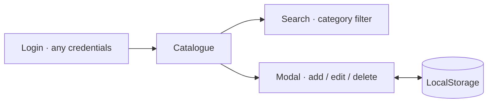

<div align="center">



<p>
  <a href="https://kahveorman.vercel.app"></a>
  
  
  
</p>

<p><em>A small, elegant catalogue and product manager for a specialty coffee shop.<br>
Mobile-first, and every bit of data lives in the browser.</em></p>

</div>


## What it is

KahveOrman was built as the final project of a JavaScript web development course. A cream-toned, centred mobile column gives it the feel of a real app. Sign in with any email and password (there is no real authentication), then browse, search and manage the products.

| | |
|---|---|
| **Live search** | Instant filtering by name, aware of Turkish characters. |
| **Categories** | Single Origin, Blend, Cold Brew, Equipment and Accessories. |
| **Full CRUD** | Add, edit and delete from a single modal. |
| **Persistent** | Everything saved in LocalStorage, no server needed. |
| **Graceful images** | Images that fail to load fall back to a coffee placeholder. |
| **Mobile first** | A soft cream palette in a phone-sized column. |




## Türkçe özet

**KahveOrman**, bir specialty kahve dükkânı için hazırlanmış küçük ve şık bir katalog ve ürün yönetim uygulaması; JavaScript web geliştirme eğitiminin proje ödevi. Backend yok, tüm veriler tarayıcının LocalStorage'ında duruyor. Türkçe karakter duyarlı canlı arama, kategori filtresi ve tek pencereden ekleme, düzenleme ve silme var.


## Development

```sh
npm install
npm run dev      # http://localhost:5173
npm run build
```

<div align="center">
<br>
<a href="https://github.com/kutluhangil"></a>
<sub>Course project · see also the Flutter version, KahveOrmanFlutterApp.</sub>
</div>
