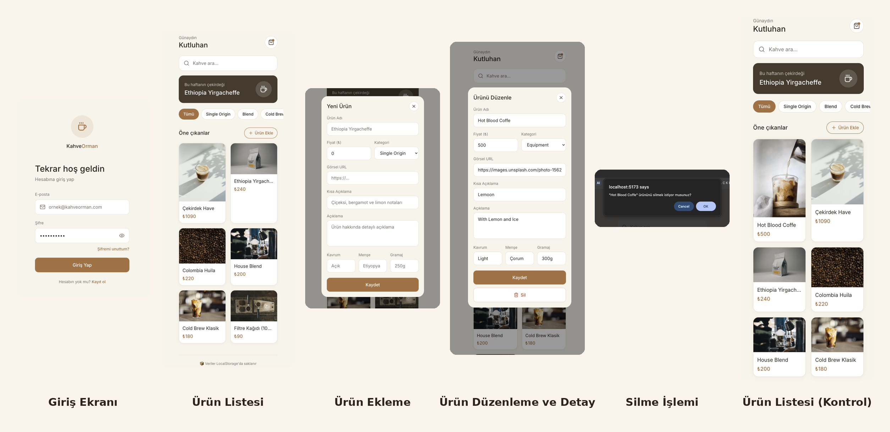
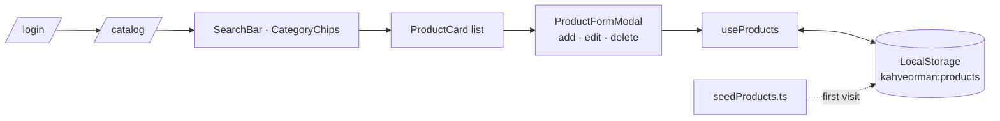

<div align="center">


<p>
  <a href="https://kahveorman.vercel.app"></a>
  
  
  
</p>

<p><em>A small, elegant catalogue and product manager for a specialty coffee shop.<br>
Search, filter, add, edit and delete, with everything kept in your browser.</em></p>



</div>


## The idea

The web edition of KahveOrman, a course project; the [Flutter version](https://github.com/kutluhangil/KahveOrmanFlutterApp) later rebuilt the same shop for mobile. The brief: a mobile-first catalogue where the shop owner can manage products without a server. So the data starts from a small seed list and lives in LocalStorage; every add, edit and delete survives a refresh.

> **No backend, on purpose.** The first visit writes the seed products to `kahveorman:products`; after that the browser is the database. Clear site data and the shop resets to its starting menu.


## Features

| | |
|---|---|
| **Sign-in screen** | A simple log-in page that leads to the catalogue (a demo gate with a prefilled password, not real authentication). |
| **Live search** | Filters by name as you type, using Turkish-aware lower-casing (`toLocaleLowerCase('tr')`). |
| **Categories** | Chips for Single Origin, Blend, Cold Brew, Equipment and Accessories. |
| **Full CRUD** | Add, edit and delete from one modal; deleting asks for confirmation. |
| **Persistent** | A `useProducts` hook keeps the list in LocalStorage. |
| **Graceful images** | A product image that fails to load falls back to a coffee placeholder. |
| **Mobile first** | A soft cream palette in a phone-sized column, Tailwind CSS. |


## How it fits together



| Seed product | Category | Price |
|---|---|---|
| Ethiopia Yirgacheffe | Single Origin | ₺240 |
| Colombia Huila | Single Origin | ₺220 |
| House Blend | Blend | ₺200 |
| Cold Brew Klasik | Cold Brew | ₺180 |
| V60 Dripper | Equipment | ₺260 |
| Filtre Kağıdı (100'lü) | Accessories | ₺90 |

<sub>Prices are sample data.</sub>


## Türkçe özet

**KahveOrman**, bir specialty kahve dükkânı için hazırlanmış küçük ve şık bir katalog ve ürün yönetimi uygulaması; bir ders projesi (aynı dükkânın Flutter sürümü de var). Türkçe karakterlere duyarlı anlık arama, kategori çipleri ve tek bir pencereden ürün ekleme, düzenleme, silme var. Veriler tarayıcının LocalStorage'ında tutuluyor, sunucu yok; ilk açılışta örnek ürünler yükleniyor.


## Development

```sh
npm install
npm run dev      # http://localhost:5173
npm run build
```

```
src/Pages/        LoginPage, CatalogPage
src/Components/   Navbar, SearchBar, CategoryChips, ProductCard, ProductFormModal, Button, Footer, icons
src/hooks/        useProducts (LocalStorage)
src/data/         seedProducts
```

<div align="center">
<br>
<a href="https://github.com/kutluhangil"></a>
<sub>Course project · see also the Flutter version, KahveOrmanFlutterApp.</sub>
</div>
